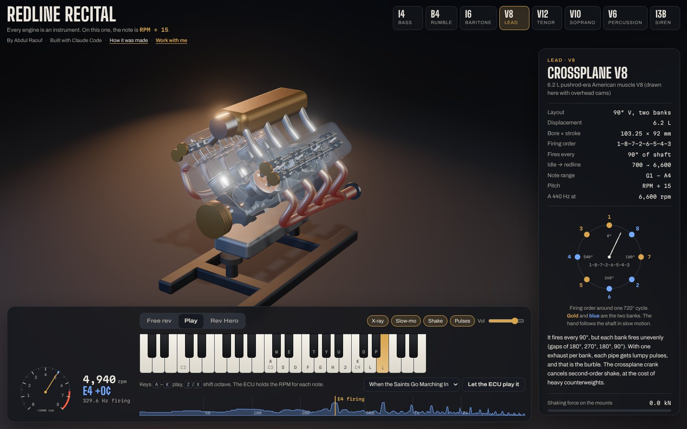

# Redline Recital



Eight engines on a studio stand, each tuned like an instrument. An engine's note is its
firing frequency: **RPM × cylinders ÷ 120** for a four-stroke, **RPM × rotors ÷ 60** for a
Wankel. A V8 at 3,300 rpm hums A3 (220 Hz).
Rev them, play them from a keyboard, or chase a melody with the throttle in Rev Hero.

Created by **Abdul Raouf**, built with **Claude Code**. Read
[how it was made](making-of.html): one sentence to a researched, tested, eight-engine site
in about two hours. Want something like this built? Email abdul.raouf9899@gmail.com.

| Engine | Firing order | Pitch | Range |
|---|---|---|---|
| Inline-4 | 1-3-4-2 | RPM ÷ 30 | bass |
| Flat-4 boxer, unequal-length headers | 1-3-2-4 | RPM ÷ 30 | rumble |
| Inline-6 | 1-5-3-6-2-4 | RPM ÷ 20 | baritone |
| Crossplane V8 | 1-8-7-2-6-5-4-3 | RPM ÷ 15 | lead |
| 60° V12 | 1-7-5-11-3-9-6-12-2-8-4-10 | RPM ÷ 10 | tenor |
| 72° F1-style V10 | 1-6-2-7-4-9-5-10-3-8 | RPM ÷ 12 | soprano |
| Lexus 4GR-FSE 60° V6, split-pin crank | 1-2-3-4-5-6 | RPM ÷ 20 | percussion (direct-injection tick) |
| Mazda Renesis 13B two-rotor | rotors alternate every 180° | RPM ÷ 30 | siren |

## Run it

```sh
npm install
npm run dev          # http://localhost:5173
npm test             # physics, voice, sim and game tests
npm run build        # typecheck + production build in dist/
npm run render-wavs  # offline renders of every engine into out/
```

## How it works

Everything comes from the engine catalog (`src/engines/catalog.ts`). Nothing is a
recording or a downloaded model.

- **Chambers and cycles**: every engine is described by its combustion chambers and the
  shaft degrees one chamber needs for a full cycle: 720° for a four-stroke cylinder,
  1,080° for a Wankel rotor face. Pitch, timing, the voice and the firing ring all use these.
- **Wankel geometry** (`src/engines/wankel.ts`): epitrochoid housing, rotor pose (orbit at
  e, turning at ⅓ shaft speed), the rotor flank computed as the housing's inner envelope,
  and the firing order derived from the geometry. Tests check the rotor never touches
  the housing and the chamber volume is 654 cc.
- **Kinematics** (`src/engines/kinematics.ts`): even firing angles from the firing order.
  Crank-pin angles come from each bore's axis, then slider-crank piston motion and valve lift.
  Tests check that every firing order matches a real crankshaft: shared V-engine pins line
  up, the V8 is a true crossplane, and the boxer's opposed pins sit 180° apart.
- **Balance** (`src/engines/balance.ts`): primary and secondary reciprocating forces and
  couples. The part counterweights can cancel is removed, and the rest drives the
  (exaggerated) mount shake.
- **Sim** (`src/sim/engineSim.ts`): torque curve, friction, pumping loss and flywheel
  inertia. It also models the fuel-cut rev limiter and the starter with its flare. A
  feedforward + PI "ECU" holds the RPM for a note.
- **Voice** (`src/audio/dsp.ts`): a pure TypeScript synth that runs in an AudioWorklet,
  with a ScriptProcessor fallback.
  - Each cylinder's exhaust valve opening fires a blowdown pulse into its exhaust bus,
    after its header delay.
  - The pulses run through a pipe resonance and a muffler.
  - On top are intake roar, valvetrain ticks, starter whine and overrun pops.
  - Tests confirm the detected pitch equals RPM × cylinders ÷ 120 for every engine.
- **3D** (`src/scene/`): Three.js with procedural geometry: crank with counterweights,
  I-beam rods, lathe-turned pistons, DOHC cams timed per valve, a glass block, headers,
  a flywheel and a stand. Effects are spark flashes, combustion glow, exhaust pulses
  and header heat.

## Limits

- The sound is synthesized. Pitch and rhythm are physically grounded, but it will not
  match a recording.
- The camera runs in slow motion by default (1/redline÷240 of real speed) so the crank
  is readable. The sound is always real time.
- The V10 firing order is geometrically consistent and F1-style, not a specific team's.
- 4GR-FSE bore, stroke, V angle and injection are factory figures; its rod length, idle
  and redline are estimates. Renesis R, e, width and redline are factory figures; its
  idle and port timing are estimates.

## Deploying

It is a static site. On Cloudflare Pages (or Netlify, Vercel, GitHub Pages):

- Build command: `npm run build`
- Output folder: `dist`
- Environment: `NODE_VERSION=22`, and `SITE_URL` set to the site's address (for example
  `https://redline-recital.pages.dev`) so social previews get absolute links.

## Media and checks

```sh
npm run render-wavs                    # WAV renders of every engine into out/
python3 scripts/figures.py             # spectrogram figures into public/media/
npx vite preview --port 4173 &         # then, with the preview running:
node scripts/capture-media.mjs         # screenshots and the 1200×630 social card
node scripts/shoot.mjs http://localhost:4173/ shots   # end-to-end browser check
```

`node scripts/artifact-page.mjs` turns `dist/index.html` into the fragment page the
claude.ai Artifact host expects.

## License

MIT, © 2026 Abdul Raouf.
